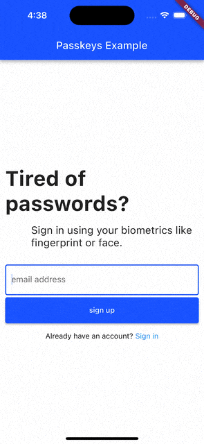

# Flutter passkeys

Flutter packages to enable passkey authentication (based on WebAuthn / FIDO2).

|             | Android            | iOS                | Linux | macOS              | Web                | Windows            |
| ----------- | ------------------ | ------------------ | ----- | ------------------ | ------------------ | ------------------ |
| **Support** | :white_check_mark: | :white_check_mark: | :x:   | :white_check_mark: | :white_check_mark: | :white_check_mark: |



## Current list of packages

### 1. Passkeys

#### Description

A Flutter package that enables simple passkey authentication.
Currently Android, iOS, macOS, Web and Windows are supported.

#### Features

- sign up and login users with passkeys
- connect your own relying party server or use pre-implemented ones

[Read more](./packages/passkeys/passkeys/README.md)

### 2. Supabase

The `passkeys` package can be used as the platform authenticator for [supabase_flutter](https://pub.dev/packages/supabase_flutter).
Supabase Auth acts as the relying party server, while `passkeys` handles the native passkey prompts on iOS, Android, macOS, Windows and Web.

It requires `supabase_flutter` 2.15.0 or later and `passkeys` 2.21.0 or later.

#### Setup

Add both packages to your `pubspec.yaml`:

```yaml
dependencies:
  supabase_flutter: ^2.15.0
  passkeys: ^2.21.0
```

Initialize Supabase as usual and create a `PasskeyAuthenticator` that you pass to the passkey methods:

```dart
import 'package:passkeys/authenticator.dart';
import 'package:supabase_flutter/supabase_flutter.dart';

await Supabase.initialize(
  url: supabaseUrl,
  anonKey: supabaseAnonKey,
);

final supabase = Supabase.instance.client;
final authenticator = PasskeyAuthenticator();
```

#### Registering a passkey

Registering a passkey requires a signed in (non-anonymous) user. It adds a passkey to the current account:

```dart
try {
  final passkey = await supabase.auth.registerPasskey(authenticator);
  print('Registered passkey ${passkey.id}');
} on AuthException catch (e) {
  print(e);
}
```

#### Signing in with a passkey

```dart
try {
  final res = await supabase.auth.signInWithPasskey(authenticator);
  print('Signed in as ${res.user?.email}');
} on AuthException catch (e) {
  print(e);
}
```

For custom flows there is also a two-step API under the `supabase.auth.passkey` namespace (`startRegistration`/`verifyRegistration` and `startAuthentication`/`verifyAuthentication`), as well as methods to list, rename and delete passkeys.

For the full guide and configuration steps, see the [Supabase passkeys documentation](https://supabase.com/docs/guides/auth/passkeys).

## Contributing

We're happy to receive your pull requests. For major changes, please open an issue first to discuss what you would like to change.

## Support

If you have questions, feedback or wishes regarding features, please reach out to us via [email](mailto:contact@corbado.com) or join our [passkeys community on Slack](https://join.slack.com/t/corbado/shared_invite/zt-1b7867yz8-V~Xr~ngmSGbt7IA~g16ZsQ).

## License

[BSD-3-clause](./LICENSE)
